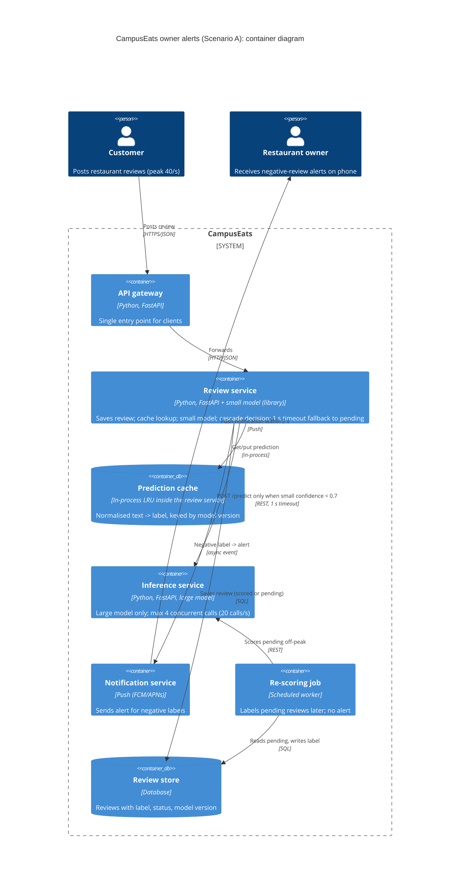

# Task 4: Deployment topologies and trade-offs

**Name / ชื่อ:** Theerayut Attajak

**Student ID / รหัสนิสิต:** 6970142021

This is **individual work**: each student completes and submits their own copy, in their own fork.

*งานนี้เป็น**งานเดี่ยว** นิสิตแต่ละคนทำและส่งงานของตัวเอง ใน fork ของตัวเอง*

**Scenario (A, B or C) / Scenario ที่เลือก:** A (Owner alerts)

Choose **one** scenario below. If the last digit of your student ID is odd, take A or B; if it is even, take B or C. Use your measurements from Tutorial 6 as evidence: cite run names from `results/runs.csv`. Answer in Thai or English.

เลือก scenario **หนึ่ง** ข้อด้านล่าง ถ้าเลขตัวสุดท้ายของรหัสนิสิตเป็นเลขคี่ ให้เลือก A หรือ B ถ้าเป็นเลขคู่ ให้เลือก B หรือ C ใช้ผลการวัดจาก tutorial ที่ทำไปเป็นข้อมูลอ้างอิง โดยอ้างชื่อ run จาก `results/runs.csv` จะตอบเป็นภาษาไทยหรือภาษาอังกฤษก็ได้

Facts that hold in every scenario / ข้อเท็จจริงที่ใช้กับทุก scenario:

- The large model serves at most **20 calls per second** (4 calls at once × about 200 ms each), and every call costs money.

  *large model รับได้สูงสุด **20 calls ต่อวินาที** (พร้อมกัน 4 calls × ประมาณ 200 ms ต่อ call) และทุก call มีค่าใช้จ่าย*
- The small model is fast and cheap enough to run anywhere, including inside the review service or on a kiosk, but it is much less accurate on its own.

  *small model เร็วและถูกพอที่จะรันที่ไหนก็ได้ รวมถึงภายใน review service หรือบน kiosk แต่ถ้าใช้ตัวเดียวจะแม่นน้อยกว่ามาก*

## Scenarios

**A. Owner alerts.** When a customer posts a negative review, the restaurant owner gets a push notification within **2 seconds**. At the lunch peak, CampusEats receives **40 reviews per second**. A missed alert is acceptable, but a wrong alert (for example, "your customer is unhappy" when they are happy) makes owners stop trusting alerts and, in the end, ignore them.

*เมื่อลูกค้าโพสต์รีวิวเชิงลบ เจ้าของร้านจะต้องได้รับ push notification ภายใน **2 วินาที** เวลาช่วงพีคตอนเที่ยง CampusEats ได้รับรีวิวจำนวน **40 รายการต่อวินาที** การพลาด alert ไปบ้างนั้นยอมรับได้ แต่ alert ที่ผิด (เช่น "ลูกค้าไม่พอใจ" ทั้งที่จริงๆ แล้วพอใจ) จะทำให้เจ้าของร้านไม่เชื่อถือและเลิกสนใจ alert ในที่สุด*

**B. Canteen kiosk.** A tablet in each canteen lets students leave a review on the spot. However, the canteen Wi-Fi is poor: the tablets lose their connection several times a day, for minutes at a time. The system must accept every review, even while a tablet is offline. Restaurant owners need the labels **by the end of the day**.

*มี tablet ในแต่ละโรงอาหารให้นิสิตรีวิวได้ทันที อย่างไรก็ดี การเชื่อมต่อ Wi-Fi ในโรงอาหารไม่ดี ทำให้ tablet หลุดการเชื่อมต่อวันละหลายครั้ง ครั้งละหลายนาที ระบบจะต้องรับรีวิวได้ทุกรายการแม้ขณะที่กำลัง offline อยู่ และเจ้าของร้านต้องการ label **ภายในสิ้นวัน***

**C. Weekly report.** Restaurant owners want a weekly sentiment report. Nothing in producing this report has to be real-time. **Accuracy matters most** and **cost must be minimal**.

*เจ้าของร้านต้องการรายงาน sentiment รายสัปดาห์ ไม่มีอะไรที่จะต้องทำแบบ real-time ในการออกรายงานนี้ ความแม่นยำ **(accuracy) สำคัญที่สุด** และ **ค่าใช้จ่ายต้องน้อยที่สุด***

## Topologies and patterns to choose from / Topology และ pattern ที่เลือกใช้ได้

| | Topology | Where the model runs / โมเดลรันที่ไหน |
|---|---|---|
| T1 | Model as a service, synchronous | Inference service, called for each review (today's baseline) *inference service ถูกเรียกทุกรีวิว (baseline ของวันนี้)* |
| T2 | Model as a library | Inside the review service, or on the device *ภายใน review service หรือบนอุปกรณ์* |
| T3 | Hybrid | Small model locally, large model as a remote service *small model รันในเครื่อง large model เป็น remote service* |
| T4 | Asynchronous / batch | Reviews are queued (broker, W10) or stored, and scored later in bulk *รีวิวถูกเข้าคิว (broker, W10) หรือเก็บไว้ แล้วติด label ทีหลังเป็นชุด* |

Combine one topology with any of the patterns from Tutorial 6: **fallback**, **cascade** and **cache**.

*เลือก topology หนึ่งแบบ แล้วผสมกับ pattern จาก Tutorial 6 ได้ตามต้องการ: **fallback**, **cascade** และ **cache***

## 1. Quality requirements

The three most important quality requirements for your scenario, each with a number where possible.

*quality requirements ที่สำคัญที่สุด 3 ข้อของ scenario ที่เลือก ระบุตัวเลขเมื่อทำได้*

| # | Quality | Requirement |
|---|---|---|
| 1 | Performance (latency) | review ที่เป็น negative ต้องถึงเจ้าของร้านเป็น push notification ภายใน **2 s** (p95) ในช่วง peak มื้อเที่ยง |
| 2 | Capacity / scalability | รองรับ **40 reviews/s** ที่ peak โดยส่ง large-model call ไม่เกิน **20 calls/s** (QR5) เป้าหมายคือ ≤ 16 calls/s ประมาณ 80% ของ capacity เพื่อเผื่อ headroom |
| 3 | Accuracy (precision ของ alert) | alert ผิดแย่กว่า alert ที่พลาดไป: ระบบต้องแม่นยำโดยรวม ≥ 93% (ระดับเดียวกับ large model, `t0-large` 93.5% / `t3-cache` 93.0%) การพลาด alert ยอมรับได้ ตัวที่สำคัญจริงคือ precision ของ alert ที่เป็น negative ซึ่งยังไม่ได้วัด (ต้องวัดเพิ่ม) |

## 2. Design / การออกแบบ

Your topology, the patterns you add, and a container-level diagram (C4 level 2). The C4 diagram must be written in Mermaid.

*topology ที่เลือก pattern ที่เพิ่ม และ diagram ระดับ container (C4 level 2) เขียนด้วย Mermaid*

**Topology: T3 Hybrid** small model รันเป็น library ภายใน review service ส่วน large model รันเป็น
inference service ระยะไกล **Patterns:** cascade (threshold 0.7) + cache + fallback

- review service เรียก cache ก่อน จากนั้นเรียก small model ใน process เดียวกัน เฉพาะ review ที่ต่ำกว่า threshold เท่านั้นที่ส่ง
  ข้ามเครือข่ายไปหา large model ดังนั้น review ส่วนใหญ่ไม่เคยออกจาก service เลย
- Fallback: ถ้า large model ไม่ตอบภายใน 1 s จะบันทึก review เป็น `pending` และ **ไม่
  ส่ง alert** การพลาด alert ยอมรับได้ แต่ alert ผิดยอมรับไม่ได้ review ที่ pending จะถูก re-score ภายหลังด้วย batch
  ซึ่งอัปเดตยอดนับแต่ไม่ส่ง alert "real-time" ที่มาช้า
- เฉพาะ label `negative` จาก large model, จาก cache หรือจาก small model ที่ ≥ threshold เท่านั้นที่ trigger
  notification service (ทางเลือกที่เข้มกว่า: ส่ง alert เฉพาะ negative ที่ large model ยืนยันแล้ว
  ได้ alert ผิดน้อยลงแลกกับ large call ที่มากขึ้นสำหรับ negative ซึ่งเป็น trade-off ระหว่าง accuracy กับ cost)

## 3. Evidence / หลักฐาน

Which runs support your choice? Show the numbers and, for scenario A, the capacity arithmetic: how many large-model calls per second does your design need at the peak?

*run ไหนที่สนับสนุนการตัดสินใจของนิสิต ให้นิสิตแสดงตัวเลขประกอบ และสำหรับ scenario A ให้นิสิตแสดงการคำนวณ capacity ด้วย เพื่อแสดงว่าในช่วงพีคนั้น design ของนิสิตต้องใช้ large model กี่ calls ต่อวินาที*

| Run | สิ่งที่แสดงให้เห็น |
|---|---|
| `t0-large` | large อย่างเดียว: 93.5% แต่ large call 100% ที่ 40 reviews/s ต้องใช้ 40 calls/s **เกิน 2 เท่า** ของเพดาน 20 calls/s คิวจึงโตไม่มีที่สิ้นสุดและเป้า 2 s ล้มเหลว ปฏิเสธ T1 |
| `t0-small` | small อย่างเดียว: p95 27 ms, large call 0 แต่ความแม่นยำ 72.5% ประมาณ 1 ใน 4 ของ alert จะผิด และเจ้าของร้านจะเลิกเชื่อ alert ปฏิเสธการใช้ T2 อย่างเดียว |
| `t2-0.7` | Cascade 0.7: 93.0% (≈ large) ด้วย large call 53% 40 × 0.53 = **21.2 calls/s > 20** cascade อย่างเดียวจึงยังเกิน capacity เล็กน้อย |
| `t3-cache` | Cascade 0.7 + cache: 93.0%, large call 38%, cache hit 35% 40 × 0.38 = **15.2 calls/s ≤ 20** (76% ของ capacity) p95 527 ms ≪ 2 s |
| `t2-0.8` | 93.5% แต่ large call 64% → 25.6 calls/s ถ้าไม่มี cache แสดงว่าทำไม threshold ที่สูงกว่าจึงไม่พอดี เว้นแต่ cache จะตัดออกได้มากพอ |
| `t1-before` / `t1-after` | large model ที่ค้างทำให้ review หาย 18 รายการและรันนาน 25.9 s เมื่อมี fallback 1 s: errors 0, pending 26, p95 1005 ms ซึ่งยังอยู่ภายใน 2 s การเป็น pending หมายถึง "ไม่มี alert" ซึ่ง scenario A อนุญาต |

## 4. ADR

Use the ADR format from W5.

*ใช้รูปแบบ ADR จาก W5*

**Title:** Hybrid small/large model with cascade, cache and fallback for real-time owner alerts

**Status:** Proposed

**Context:** เจ้าของร้านต้องได้รับ push alert สำหรับ review ที่เป็น negative ภายใน 2 s load ที่ peak คือ 40 reviews/s แต่
large model ที่ต้องจ่ายเงินรองรับได้สูงสุด 20 calls/s alert ผิดทำลายความเชื่อใจของเจ้าของร้าน ส่วน alert ที่พลาดไป
ยังพอรับได้ ผลการวัด: large อย่างเดียวแม่นยำ 93.5% แต่ต้องใช้ 40 calls/s (`t0-large`) small อย่างเดียว
แม่นยำ 72.5% (`t0-small`)

**Decision:** รัน small model ใน process ของ review service (T3 hybrid) ใช้ cascade ที่
threshold 0.7 และ LRU prediction cache ที่ใช้ key เป็นข้อความที่ normalise แล้วรวมกับ model version เรียก large
model ระยะไกลเฉพาะ review ที่ confidence ต่ำ โดยมี timeout 1 s เมื่อ timeout หรือ error ให้บันทึก review เป็น pending ไม่ส่ง
alert และ re-score ด้วย batch job ภายหลัง

**Consequences:**
- Positive: large call 15.2 calls/s ที่ peak (76% ของ capacity) แทนที่จะเป็น 40 ความแม่นยำ 93.0% ใกล้เคียง large อย่างเดียว
  p95 527 ms อยู่ภายใน 2 s สบายๆ ต้นทุน large call ลดลง 62% large model ที่ค้างจะเสื่อมถอยเป็นแค่ alert ที่พลาดไป
  ไม่ใช่ review หายหรือทั้งระบบหยุดชะงัก
- Negative: คำตอบที่ small model มั่นใจแต่ผิด (ประโยคปฏิเสธ, การประชด) จะข้าม large model ไปและอาจ
  ทำให้เกิด alert ผิด margin ของ capacity ขึ้นกับ cache hit rate ตอนนี้ small model ถูก ship ไปพร้อมกับ
  review service ทำให้สอง deployment ผูกกัน (อัปเดต model หมายถึงต้อง redeploy review service) cache ต้องถูก
  invalidate เมื่อเปลี่ยน model review ที่ pending จะไม่ได้ alert แบบ real-time เลย

**Alternatives considered:** at least one topology you rejected, and why.

*อย่างน้อยหนึ่ง topology ที่ไม่เลือก และเหตุผล*

- T1 model as a service ใช้ large อย่างเดียว: แม่นยำที่สุด แต่ต้องใช้ 40 calls/s เป็นสองเท่าของ capacity ปฏิเสธ
- T2 small model as a library อย่างเดียว: เร็วและฟรี แต่ความแม่นยำ 72.5% ทำให้ alert ผิดเยอะเกินไป ปฏิเสธ
- T4 async/batch: ปกป้อง capacity ได้ แต่การให้คะแนนแบบเข้าคิวรับประกัน alert ภายใน 2 s ไม่ได้ เก็บไว้ใช้เฉพาะกับ review ที่ pending
